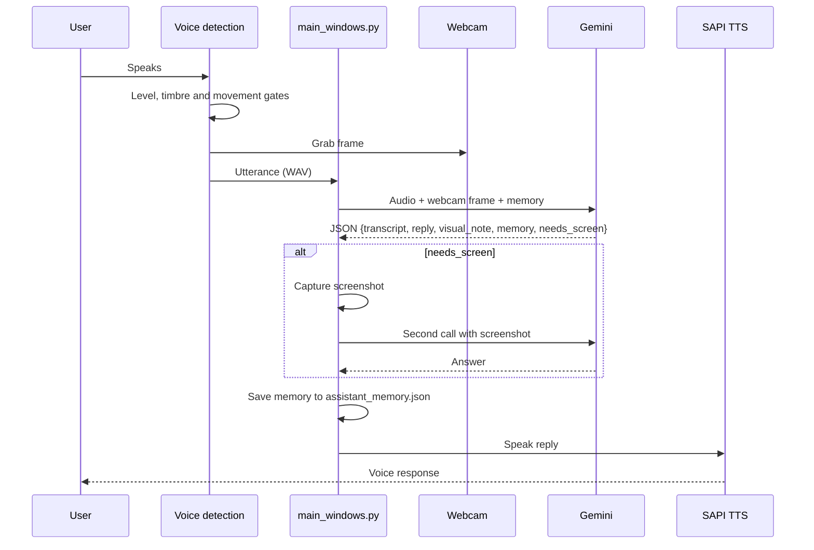

# Talk-Screen-AI-Windows

A voice-first AI room assistant for Windows, powered by Google Gemini. It listens through your microphone, sees you through your webcam, looks at your screen when you ask about it, and talks back with local text-to-speech. Over time it builds a long-term picture of who you are, so conversations feel like talking to a room-mate rather than a chatbot.

## Features

- **Hands-free voice conversation**: speak naturally; replies are spoken aloud with Windows SAPI (`pyttsx3`).
- **Robust voice detection**: three independent gates (adaptive loudness, voice timbre, spectral movement) filter out door slams, keyboard clicks, fans, and alarm tones before anything is sent to the API.
- **Webcam awareness**: a frame is captured the moment you start speaking and attached to every turn.
- **Screen on demand**: when you ask about your work ("what's wrong with this?"), the assistant takes a screenshot and answers from it. Set `SCREEN_CAPTURE_ENABLED=0` to disable this.
- **Persistent memory**: durable facts about you (identity, research, hobbies, room, and so on) are stored in `assistant_memory.json` and folded into every turn.
- **Proactive but polite**: it may open a conversation when it hears you nearby, with cooldowns so it never nags.
- **Single API call per turn**: transcription, answer, scene note, and memory update come back in one Gemini request to keep cost and latency low.
- **Quota-friendly**: backs off automatically on 429/quota errors instead of stopping.

## Entry points

| Script | Description |
|---|---|
| `src/main_windows.py` | **Recommended.** Windows-only persistent room assistant (webcam + on-demand screen + local TTS + memory). |
| `src/main.py` | Older, cross-platform version built on the Gemini Live API (continuous screen streaming). |

## How a turn works (`main_windows.py`)



## Requirements

- Windows 10/11
- Python 3.11 or later
- Microphone, speaker or headphones, webcam
- A Gemini API key ([Google AI Studio](https://aistudio.google.com/))

## Quick start

```powershell
git clone https://github.com/Tabibito-AI/Talk-Screen-AI-Windows.git
cd Talk-Screen-AI-Windows
python -m venv .venv
.venv\Scripts\pip.exe install -r requirements.txt
```

Create a `.env` file in the repository root:

```
GEMINI_API_KEY=your_api_key_here
GEMINI_MODEL=gemini-3.6-flash
```

Run it:

```powershell
.venv\Scripts\python.exe src\main_windows.py
```

Talk to it, or type at the `message >` prompt. Type `q` to quit.

See [SETUP.md](SETUP.md) for detailed setup (English / 日本語), and [CLAUDE.md](CLAUDE.md) for architecture notes and the full list of tunables (voice-detection thresholds, TTS voice/rate, proactive cooldowns, camera/mic/monitor selection).

## Privacy

- Each voice turn sends your microphone audio and a webcam frame to the Gemini API.
- Screen questions send a screenshot of your desktop. Disable with `SCREEN_CAPTURE_ENABLED=0`.
- Memory is stored locally in `assistant_memory.json`. Delete the file to reset it.

## License

MIT License
